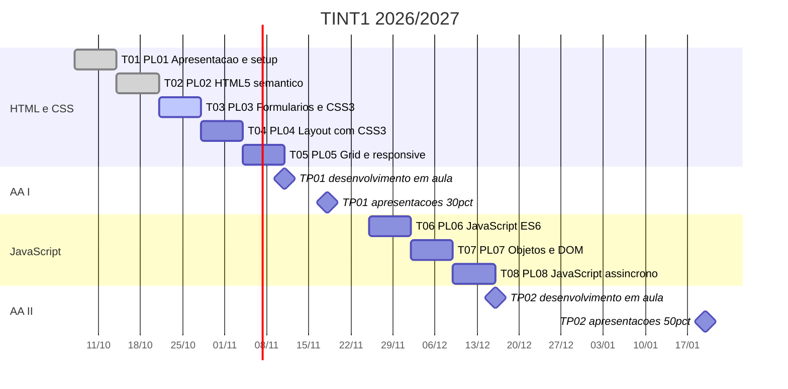

# Plano e avaliação

Fonte: FUC (apresentação), planificação oficial 2026/2027 e diapositivo 3 da T01. Documentos em `00_FUC/`.

## Como funciona a UC

| Componente | Peso | O que é |
|---|---|---|
| Aulas práticas | 20% da AC | Uma ficha PL por aula. Entrega no Moodle no fim da aula. Conta o trabalho feito em aula. |
| TP01 / AA I | 30% da AC | Individual: página web responsiva em HTML5 e CSS3. Desenvolvimento em aula a 11/11; apresentação a 18/11 (10 minutos). |
| TP02 / AA II | 50% da AC | Grupo de 2 a 3: JavaScript, DOM e Fetch API. Grupos fechados a 09/12; desenvolvimento a 16/12; apresentação a 20/01 (10 minutos). |

A avaliação contínua (AC) vale **40%** da nota final. O exame final vale **60%**.

### Exame final (Fevereiro)

| Parte | Peso | Conteúdo | Regra |
|---|---|---|---|
| I — Teórico-prática | 60% (12 valores) | Fundamentos de HTML5, CSS3 e JavaScript | Sempre obrigatória, com mínimo de 8 valores |
| II — Prática | 40% (8 valores) | Implementação de página e de scripts | Dispensada para quem realizar avaliação contínua |

## Calendário

| Data | Aula | Tema | Recursos | Marco de avaliação |
|---|---|---|---|---|
| 07/10 | 1 | Apresentação e setup: evolução da Web, cliente-servidor, estrutura HTML5 | T01 / PL01 | Ficha diagnóstica |
| 14/10 | 2 | HTML5 semântico: estrutura, texto, tabelas e conteúdo embebido | T02 / PL02 | |
| 21/10 | 3 | Formulários e CSS3: formulários, validação, seletores e box model | T03 / PL03 | |
| 28/10 | 4 | Layout com CSS3: texto, background, posicionamento e Flexbox | T04 / PL04 | |
| 04/11 | 5 | Grid e responsive: Grid Layout, media queries e acessibilidade | T05 / PL05 | |
| 11/11 | 6 | TP01: enunciado e desenvolvimento em aula (4h) | TP01 | Enunciado AA I |
| 18/11 | 7 | TP01: apresentações (10 min por estudante) | TP01 | **AA I (30%)** |
| 25/11 | 8 | JavaScript ES6+: tipos, operadores, controlo, arrays e funções | T06 / PL06 | |
| 02/12 | 9 | Objetos e DOM: objetos, DOM, eventos e Web Storage | T07 / PL07 | Grupos e tema AA II |
| 09/12 | 10 | JavaScript assíncrono: Promises, async/await, Fetch, JSON e geolocalização | T08 / PL08 | Fecho dos grupos |
| 16/12 | 11 | TP02: enunciado e desenvolvimento em aula (4h) | TP02 | Enunciado AA II |
| 20/01 | 12 | TP02: apresentações (10 min por grupo) | TP02 | **AA II (50%)** |

Ritmo da matéria: HTML até Outubro, CSS até Novembro, JavaScript em Novembro e Dezembro.

## Datas-chave

- **11/11** — TP01: enunciado e 4h de desenvolvimento em aula.
- **18/11** — TP01: apresentação individual de 10 minutos. Vale 30% da AC.
- **02/12** — Definição dos grupos e do tema da AA II.
- **09/12** — Grupos fechados.
- **16/12** — TP02: enunciado e 4h de desenvolvimento em aula.
- **20/01** — TP02: apresentação de 10 minutos por grupo. Vale 50% da AC.
- **Fevereiro** — Exame final.

## Regras das fichas PL

- Modalidade individual, feitas em aula (65 a 70 minutos). Os extras são opcionais.
- Entrega no Moodle **até ao fim da aula**, num `.zip` com o nome `PLxx_<número>_<nome>.zip`.
- Cada entrega inclui a pasta do exercício (`pl01/`, `pl02/`...), um `respostas.txt` com as tabelas e respostas pedidas e a captura `validador.png` com 0 erros.
- **IA**: tentar primeiro sozinho. Se for usada, indicar no fim do `respostas.txt` o que foi pedido e o que foi aproveitado.
- Validar sempre antes de entregar: 0 erros no validador do W3C.

## Documentação de referência

- Bibliografia da FUC: ver a secção *Referências* do [README](../README.md).
- Em aula: [MDN Web Docs](https://developer.mozilla.org) (secção HTML) e [validator.w3.org](https://validator.w3.org/).
