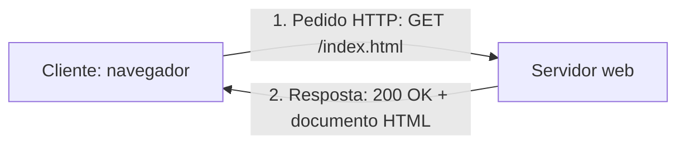

# T01 — A Web, o modelo cliente-servidor e o primeiro documento HTML5

Aula de 07/10/2026. Diapositivos em `01_Teoricas/LEI-A1-S1-TINT1-T01.pdf`. Ficha associada: PL01.

**No fim desta aula:** explicar o caminho de uma página do servidor até ao navegador; ter VS Code, navegador e validador prontos; escrever, abrir e validar o primeiro documento HTML5.

## 1. A Web

### Internet e Web não são a mesma coisa

| Internet | Web |
|---|---|
| A rede: rede mundial de redes, com cabos, routers e o protocolo TCP/IP | Um serviço que corre na rede |
| Nasce em 1969 com a ARPANET | Proposta em 1989 por Tim Berners-Lee, no CERN |
| Transporta muitos serviços: email, jogos, streaming... e a Web | Documentos ligados por hiperligações; assenta em URL, HTTP e HTML |

### Linha do tempo

| Ano | Marco |
|---|---|
| 1969 | ARPANET, a rede que dá origem à Internet |
| 1989 | Proposta da Web por Tim Berners-Lee, no CERN |
| 1990 | Primeiro servidor e primeiro navegador (WorldWideWeb), num NeXT |
| 1991 | Primeiro website público: `info.cern.ch` (ainda online, só texto e ligações) |
| 1993 | CERN coloca o software da Web no domínio público; NCSA Mosaic, o navegador gráfico que populariza a Web |
| 1995 | JavaScript: páginas com comportamento |
| 1996 | CSS1: separar estrutura e aspecto |
| 2014 | HTML5, recomendação oficial do W3C |
| 2019 | HTML Living Standard: norma única, mantida pelo WHATWG |

Nesta UC trabalha-se com o HTML Living Standard, que continuamos a chamar HTML5. Havia 1 website em Agosto de 1991 e cerca de 1630 milhões em Junho de 2018, a maioria inactivos ou estacionados.

### Três linguagens, três papéis

| Linguagem | Papel | Diz... |
|---|---|---|
| HTML | Estrutura | o que cada coisa é: título, parágrafo, imagem, ligação |
| CSS | Apresentação | como se vê: cores, tipos de letra, posição, tamanho |
| JavaScript | Comportamento | o que acontece: cliques, validações, dados |

## 2. Cliente-servidor



- O cliente pede, o servidor responde. O servidor nunca envia nada sem lhe pedirem.
- **Um pedido por recurso.** O HTML chega primeiro; depois o navegador pede o CSS, o JavaScript e cada imagem.
- **Sem memória.** O HTTP não se lembra de pedidos anteriores; cada pedido é independente.

### Do URL ao ecrã

1. Escrever o URL (`https://istec-porto.pt`).
2. **DNS** traduz o nome num endereço IP.
3. **Ligação** TCP, cifrada com TLS se for `https`.
4. **Pedido HTTP**: `GET /` ao servidor.
5. **Resposta**: código 200 e o HTML.
6. **Desenho**: o navegador monta e mostra a página.

Tudo em menos de um segundo, em regra. Os passos vêem-se no separador Rede das DevTools; DNS e TCP são matéria de Redes e Comunicações.

### Anatomia de um URL

```
https://istec-porto.pt/cursos/lei.html?ano=1#plano
```

| Parte | Exemplo | Significado |
|---|---|---|
| Protocolo | `https://` | Como falar com o servidor; o `s` quer dizer ligação cifrada |
| Domínio | `istec-porto.pt` | Nome do servidor; o DNS converte-o num IP |
| Caminho | `/cursos/lei.html` | O recurso pedido dentro do servidor |
| Parâmetros | `?ano=1` | Dados extra enviados ao servidor, `nome=valor` |
| Fragmento | `#plano` | Uma secção da página; não é enviado ao servidor |

### Pedido e resposta HTTP

```http
GET /index.html HTTP/1.1
Host: istec-porto.pt
User-Agent: Mozilla/5.0 ...
Accept: text/html
```

```http
HTTP/1.1 200 OK
Content-Type: text/html; charset=UTF-8

<!DOCTYPE html>
<html lang="pt-PT">
...
```

| Código | Significado |
|---|---|
| 200 | OK: correu bem, aqui está o recurso |
| 301 | Movido: o recurso mudou de endereço |
| 404 | Não encontrado: o recurso não existe nesse caminho |
| 500 | Erro no servidor: a culpa é do servidor, não do cliente |

Na PL01 viu-se que uma página de erro pode parecer normal (Wikipédia) e continuar a devolver 404: só nas DevTools se vê o código.

## 3. Ferramentas

VS Code, navegador com DevTools, validador do W3C e Git. Detalhes, atalhos e Emmet em [ambiente-e-ferramentas.md](ambiente-e-ferramentas.md).

## 4. O documento HTML5

### Anatomia de um elemento

```html
<a href="https://istec-porto.pt">ISTEC Porto</a>
```

- Etiqueta de abertura `<a ...>`, conteúdo `ISTEC Porto`, etiqueta de fecho `</a>`.
- Atributo `href` com valor entre aspas.
- Elementos vazios, sem conteúdo nem fecho: ``, `<br>`, `<meta charset="UTF-8">`.

### O documento mínimo

```html
<!DOCTYPE html>
<html lang="pt-PT">
<head>
  <meta charset="UTF-8">
  <meta name="viewport" content="width=device-width, initial-scale=1.0">
  <title>Primeira página</title>
</head>
<body>
  <h1>Olá, Web!</h1>
  <p>Sou o ...</p>
</body>
</html>
```

| Linha | Para quê |
|---|---|
| `<!DOCTYPE html>` | Diz ao navegador que é HTML5 |
| `lang="pt-PT"` | Língua do conteúdo: leitores de ecrã, tradução, pesquisa |
| `<head>` | Metadados; nada disto aparece na página |
| `charset="UTF-8"` | Para á, ç, ã aparecerem bem |
| `viewport` | A página adapta-se ao ecrã do telemóvel |
| `<title>` | Texto do separador e dos resultados de pesquisa |
| `<body>` | Tudo o que o utilizador vê |

### Os primeiros elementos

| Elemento | Para que serve | Exemplo |
|---|---|---|
| `<h1>` ... `<h6>` | Títulos, do mais importante ao menos importante | `<h1>Ana Costa</h1>` |
| `<p>` | Parágrafo: um bloco de texto com uma ideia | `<p>Sou estudante de LEI.</p>` |
| `<br>` | Quebra de linha dentro do mesmo texto (vazio) | `Rua do ISTEC<br>Porto` |
| `<a>` | Ligação para outra página, ficheiro ou secção | `<a href="sobre.html">Sobre</a>` |
| `` | Imagem (vazio, `alt` obrigatório) | `` |
| `<!-- -->` | Comentário: o navegador ignora | `<!-- PL01 · Ana -->` |

### Títulos

1. **Um só `h1` por página**: o título principal, normalmente o nome da página ou do site.
2. **Não saltar níveis**: depois de `h1` vem `h2`; um `h3` só aparece dentro de um `h2`.
3. **Escolher pelo significado**: para letra pequena, usar o nível certo e mudar o tamanho no CSS.

### Parágrafos e `<br>`

O navegador junta espaços e mudanças de linha num só espaço; a forma como o código está alinhado não muda o que se vê.

- Nova ideia → novo `<p>`.
- Mesma ideia, linha nova → `<br>` (ex.: morada).
- **Nunca `<br><br>` para dar espaço**: o espaçamento faz-se com CSS.

### Ligações e caminhos

| Tipo | Quando | Exemplo |
|---|---|---|
| Absoluto | Outro site: endereço completo com protocolo | `<a href="https://istec-porto.pt">` |
| Relativo | Ficheiro do projecto, a partir da pasta do `index.html` | `<a href="sobre.html">`, `src="img/avatar.png"` |
| Fragmento | Secção da mesma página, marcada com `id` | `<a href="#ligacoes">` → `<h2 id="ligacoes">` |

Nunca usar caminhos do disco (`C:\Users\Ana\Desktop\foto.png`): funcionam num computador e falham em todos os outros. Para subir um nível numa pasta: `../index.html`.

### Imagens

```html

```

- `src`: onde está o ficheiro, em caminho relativo.
- `alt`: o que a imagem mostra, para quem não a vê. **Obrigatório.** Bom: `"Logótipo do ISTEC Porto"`. A evitar: `"imagem"`, `"foto1.png"`.
- `width`: largura em píxeis, só o número; a altura ajusta-se.
- Formatos: jpg para fotos, png para gráficos, svg para ícones.

### Comentários e código-fonte

- Comentário: de `<!--` a `-->`. O navegador ignora-o. Atalho Ctrl + /.
- **Segurança**: os comentários não aparecem na página, mas qualquer pessoa os lê com Ctrl + U. Nunca escrever palavras-passe, chaves ou dados pessoais em comentários.

### A árvore do documento (DOM)

Caixas dentro de caixas: cada elemento tem um pai e pode ter filhos. `<html>` é a raiz; `<head>` e `<body>` são irmãos. O navegador transforma o texto nesta árvore, o DOM, que em Dezembro se manipula com JavaScript.

### Regras de ouro do HTML

1. Fechar o que se abre e respeitar o aninhamento.
2. Etiquetas e atributos em minúsculas; valores entre aspas.
3. Indentar: cada nível, dois espaços para dentro.
4. Escolher o elemento pelo significado, não pelo aspecto (`<h2>` e não `<b>` para títulos).
5. Validar sempre antes de entregar: 0 erros em validator.w3.org.

### Se algo falhar

| Sintoma | Causa provável | Solução |
|---|---|---|
| Acentos aparecem como `é` ou `ç` | Falta `<meta charset="UTF-8">` ou o ficheiro não está em UTF-8 | Acrescentar o meta e confirmar UTF-8 no canto inferior direito do VS Code |
| A página não muda | Não guardou ou abriu outro ficheiro | Ctrl + S ou Auto Save; confirmar o nome do ficheiro |
| O `!` não gera o modelo | O ficheiro ainda não tem extensão `.html` | Guardar como `index.html` e tentar de novo |
| Texto a negrito até ao fim da página | Etiqueta sem fecho | Fechar a etiqueta; o validador indica a linha |
| Live Server não aparece | Extensão por instalar ou pasta não aberta | Instalar a extensão e usar File > Open Folder |

## O que levar desta aula

- **Internet e Web**: a Web é um serviço que corre na Internet, assente em URL, HTTP e HTML.
- **Cliente-servidor**: o navegador pede, o servidor responde; um pedido por recurso.
- **Ferramentas**: VS Code, DevTools, validador do W3C e Git.
- **Documento HTML5**: DOCTYPE, html, head e body. Validar sempre.

Próxima aula: HTML5 semântico, texto, tabelas e conteúdo embebido ([resumo-T02.md](resumo-T02.md)).
