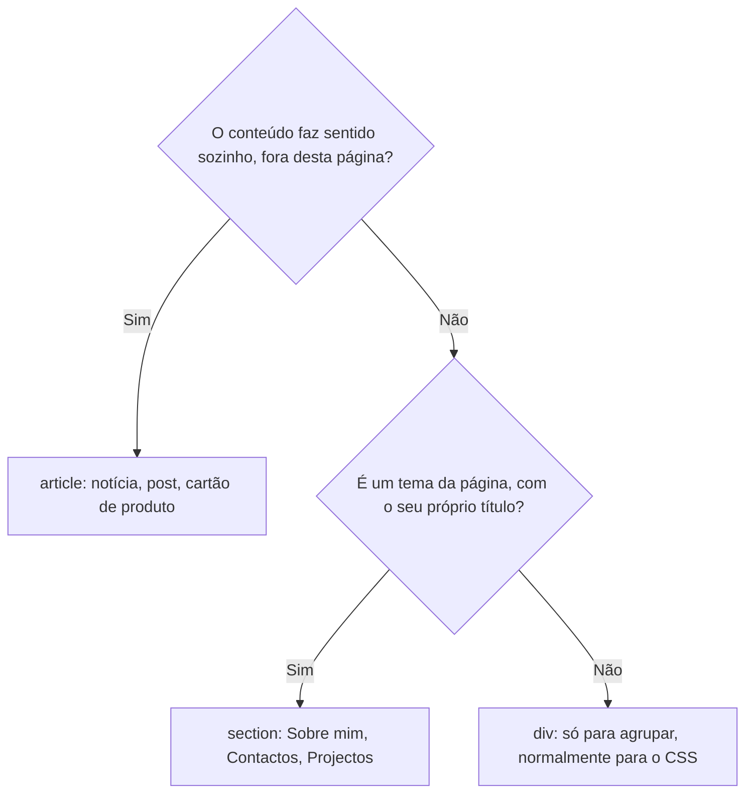

# T02 — HTML5 semântico: estrutura, texto, tabelas e conteúdo embebido

Aula planificada para 14/10/2026 (dada a 21/10 segundo os ficheiros). Diapositivos em `01_Teoricas/LEI-A1-S1-TINT1-T02.pdf`; exemplos em `01_Teoricas/t02-exemplos/`. Ficha associada: PL02.

**No fim desta aula:** organizar uma página com `header`, `nav`, `main`, `section`, `article`, `aside` e `footer`; escolher o elemento de texto e de lista certo; construir tabelas acessíveis e incorporar imagens, vídeo, áudio e mapas.

## Revisão da T01

1. As três linhas obrigatórias antes do `<head>`: `<!DOCTYPE html>`, `<html lang="pt-PT">` e, dentro do `head`, `<meta charset="UTF-8">`, `<meta name="viewport" ...>` e `<title>`.
2. `href="sobre.html"` é um caminho relativo (ficheiro do projecto); `href="https://istec-porto.pt"` é absoluto (outro site).
3. Um só `h1` por página. Não se salta de `h1` para `h3`.
4. O validador acusa erro num `` sem `alt` porque o `alt` é obrigatório: descreve a imagem a quem não a vê.

## 1. Estrutura semântica

### Divs ou semântica?

Antes do HTML5 só havia `div`, com nomes inventados (`class="cabecalho"`, `class="menu"`). O HTML5 dá nome a cada parte. O aspecto é igual: os elementos dão significado, não estilo. Vantagens:

- **Acessibilidade**: leitores de ecrã saltam directamente para o `main` ou para a `nav`.
- **Motores de pesquisa**: percebem o que é conteúdo principal e o que é menu ou rodapé.
- **Código legível**: qualquer colega percebe a estrutura sem ler classes inventadas.

### Os elementos estruturais

| Elemento | Para quê |
|---|---|
| `header` | Cabeçalho: logótipo, título, por vezes a navegação |
| `nav` | Bloco de navegação principal (menu) |
| `main` | Conteúdo principal. **Só um por página** |
| `section` | Secção temática, com o seu título (`h2`) |
| `article` | Conteúdo que faz sentido sozinho: notícia, post, cartão |
| `aside` | Conteúdo lateral, relacionado mas acessório |
| `footer` | Rodapé: autor, direitos, contactos |

Exemplo completo em `t02-exemplos/semantica.html`.

### `section`, `article` ou `div`?



Regra prática: se não se consegue dar um título à secção, provavelmente é um `div`. Um `article` pode ter as suas `section`, e uma `section` pode ter vários `article`.

### Regras e erros comuns

- Um só `<main>` por página, e nunca dentro de `header`, `nav`, `aside` ou `footer`.
- `<nav>` só para a navegação principal. Uma ligação solta no texto não precisa de `nav`.
- Cada `<section>` com o seu título, normalmente `h2`. Sem título, é um `div`.
- `header` e `footer` podem repetir-se: um `article` pode ter o seu próprio `header` e `footer`.
- Não escolher pelo aspecto: o visual é com o CSS.

## 2. Texto e listas

### Ênfase no texto

| Elemento | Significa | Não confundir com |
|---|---|---|
| `<strong>` | Importância | `<b>`: só negrito, sem significado |
| `<em>` | Ênfase na leitura | `<i>`: só itálico (termos, nomes) |
| `<mark>` | Destaque, relevância | Sublinhar por estética: CSS |
| `<abbr title="...">` | Abreviatura explicada (aparece ao passar o rato) | |
| `<code>` | Código | |
| `<small>` | Nota legal, letra pequena | |
| `<time datetime="2026-10-14">` | Data legível por máquinas | |

Exemplo em `t02-exemplos/texto.html`.

### Citações

- `<blockquote>`: citação em bloco, com recuo. Leva os `<p>` lá dentro.
- `<q>`: citação curta, dentro do texto. Com `lang="pt-PT"` o navegador põe as aspas «».

### Entidades

| Entidade | Mostra | Para quê |
|---|---|---|
| `&lt;` | `<` | Escrever código no texto |
| `&gt;` | `>` | Idem |
| `&amp;` | `&` | O próprio & |
| `&quot;` | `"` | Aspas dentro de atributos |
| `&copy;` | © | Direitos de autor |
| `&nbsp;` | (espaço) | Espaço que não quebra a linha |

Desafio da aula: para escrever literalmente `<p>` numa página sem criar um parágrafo, usa-se `<code>&lt;p&gt;</code>`.

### Três tipos de lista

| Lista | Quando | Itens |
|---|---|---|
| `<ul>` | Não ordenada: a ordem não importa (ingredientes, hobbies) | `<li>` |
| `<ol>` | Ordenada: passos, rankings | `<li>` |
| `<dl>` | Glossário: termos e definições | `<dt>` termo, `<dd>` definição |

**Regra:** dentro de `ul` e `ol` só pode haver `li`. Uma sublista vai **dentro de um `li`**, com a sua própria `ul`/`ol`:

```html
<ol>
  <li>Abrir no VS Code
    <ul>
      <li>File › Open Folder</li>
    </ul>
  </li>
</ol>
```

Exemplo em `t02-exemplos/listas.html`. Escolher o elemento: ingredientes → `ul`; passos da receita → `ol`; glossário → `dl`; destaque numa frase → `strong`/`mark`; menu principal → `nav` com `ul`; notícia → `article`.

## 3. Tabelas

### Anatomia

| Elemento | Para quê |
|---|---|
| `<caption>` | Legenda: diz de que trata a tabela. É lida primeiro pelo leitor de ecrã |
| `<thead>`, `<tbody>`, `<tfoot>` | Separam cabeçalho, dados e totais |
| `<tr>` | Linha (table row) |
| `<th>` | Célula de cabeçalho (negrito e centrada) |
| `<td>` | Célula de dados (table data) |
| `scope="col"` / `scope="row"` | Cabeçalho de coluna / de linha |
| `colspan="2"` | Célula que ocupa 2 colunas, para a direita; nessa linha escreve-se menos um `td` |
| `rowspan="2"` | Célula que ocupa 2 linhas, para baixo; na linha seguinte escreve-se menos um `td` |

Exemplo completo em `t02-exemplos/tabela.html`; spans em `t02-exemplos/spans.html`.

Sem CSS, a tabela não tem contornos. Regra usada na aula (explicada a partir da T03):

```css
table, th, td { border: 1px solid #999; border-collapse: collapse; padding: 6px 10px; }
```

**Truque:** desenhar a tabela no papel antes de a escrever e contar as células de cada linha. Com os spans, todas as linhas têm de dar o mesmo número de colunas.

### Tabelas acessíveis

- Fazer sempre: `caption`, `th scope="col"`, `th scope="row"`, `thead`/`tbody`/`tfoot`.
- **Nunca** usar tabelas para paginar o site (colunas, menus, rodapés): isso é CSS, com Flexbox e Grid em Novembro.
- Pergunta de controlo: se faz sentido ter títulos de coluna, é uma tabela; se não faz, provavelmente é uma lista.

## 4. Conteúdo embebido

### Figura com legenda

```html
<figure>
  
  <figcaption>Figura 1: o avatar da Ana Costa.</figcaption>
</figure>
```

`figure` agrupa o conteúdo e a legenda; `figcaption` vai em primeiro ou em último. O `alt` substitui a imagem; a legenda acrescenta informação a todos.

### Vídeo e áudio

```html
<video controls width="400" poster="media/poster.jpg" preload="none">
  <source src="media/apresentacao.webm" type="video/webm">
  <source src="media/apresentacao.mp4" type="video/mp4">
  O teu navegador não suporta vídeo.
</video>
<audio src="media/som.mp3" controls></audio>
```

- `controls` mostra os botões; sem ele, o utilizador não consegue tocar.
- `poster`: imagem antes de começar.
- `<source>` vários formatos: o navegador usa o primeiro que consegue. Vídeo em MP4 e WebM, áudio em MP3, na pasta `media/`.
- `autoplay muted`: só toca sozinho se estiver sem som.

### Iframe

```html
<iframe
  src="https://www.openstreetmap.org/export/embed.html?bbox=...&amp;layer=mapnik&amp;marker=..."
  width="520" height="300" title="Mapa com a localização do ISTEC Porto"></iframe>
```

- `src`: endereço da página a incorporar (mapa, vídeo do YouTube). Em openstreetmap.org: Partilhar > HTML.
- `title`: descreve o conteúdo para leitores de ecrã. Obrigatório nas entregas.
- Atribuição obrigatória no rodapé: `Mapa: &copy; OpenStreetMap contributors` (licença ODbL).
- **Segurança**: só incorporar sites de confiança. Muitos sites recusam ser incorporados (aparece em branco ou com erro), por exemplo google.com.

### Organizar os ficheiros

Ver [ambiente-e-ferramentas.md](ambiente-e-ferramentas.md#criar-um-projecto): `img/` e `media/`, nomes simples, caminhos relativos, ficheiros leves, direitos de autor.

## Prática guiada da aula

1. Copiar a pasta `pl01` para `pl02` e abrir no VS Code.
2. Envolver o conteúdo em `header` (h1 e nav), `main` e `footer`.
3. Transformar cada `h2` e o seu conteúdo numa `section`.
4. Trocar o parágrafo dos hobbies por uma lista `ul`.
5. Acrescentar um `footer` com `&copy;` e o ano, e validar.

## Validar a estrutura

Activar **Show: outline** no validador. Exemplo de outline esperado:

```
<h1> Ana Costa
    <h2> Sobre mim
        <h3> Hobbies
    <h2> Ligações
```

Erros que o validador apanha nesta matéria estão listados em [ambiente-e-ferramentas.md](ambiente-e-ferramentas.md#validador-do-w3c).

## Se algo falhar

| Sintoma | Causa provável | Solução |
|---|---|---|
| O vídeo não toca | Formato não suportado ou caminho errado | Acrescentar um `<source>` WebM e confirmar `media/...` |
| Não há botões no vídeo | Falta o atributo `controls` | `<video controls>` |
| O iframe aparece em branco | O site recusa ser incorporado | Usar o código de partilha oficial (Partilhar > Incorporar) |
| A tabela não tem linhas | É o normal sem CSS | Copiar a regra `border` do exemplo |
| A tabela está torta | `colspan` ou `rowspan` mal contados | Contar as células de cada linha no papel |
| O texto `<p>` desaparece | O navegador leu-o como etiqueta | Escrever `&lt;p&gt;` |

## O que levar desta aula

- **Estrutura**: `header`, `nav`, `main`, `section`, `article`, `aside`, `footer`.
- **Texto e listas**: `strong`, `em`, `blockquote`, entidades; `ul`, `ol` e `dl`.
- **Tabelas**: `caption`, `thead`, `tbody`, `th` com `scope`, `colspan` e `rowspan`.
- **Embebido**: `figure`, `video`, `audio` e `iframe`, com ficheiros organizados.

Próxima aula: formulários e validação, e os primeiros passos em CSS (T03 / PL03).
